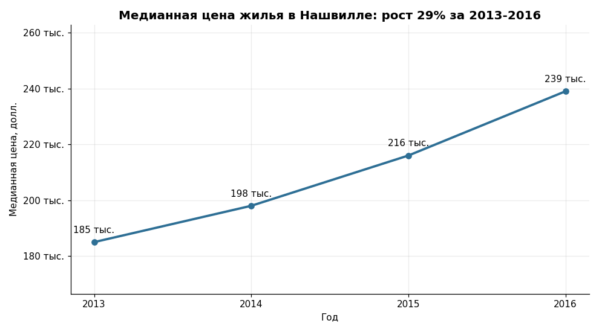
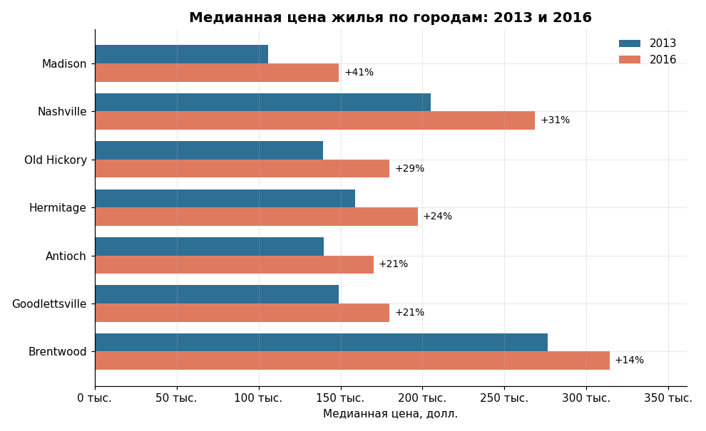
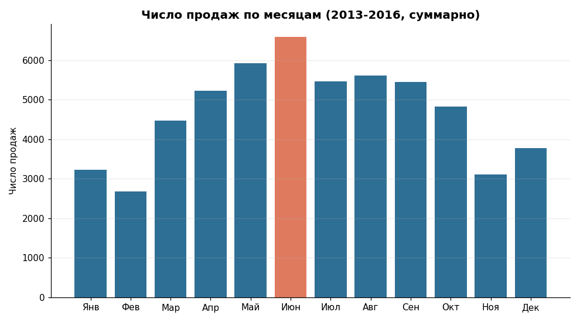
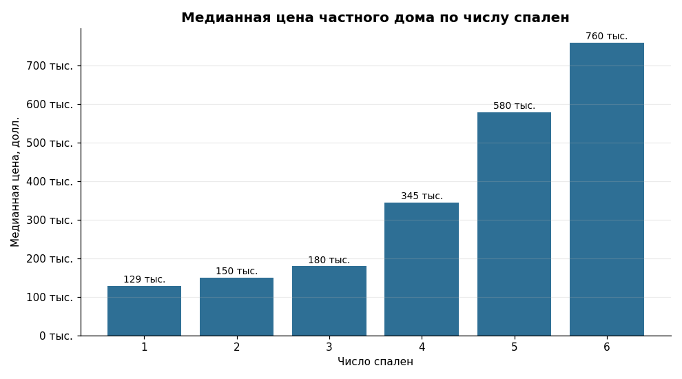
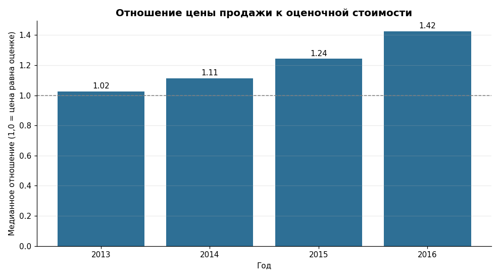
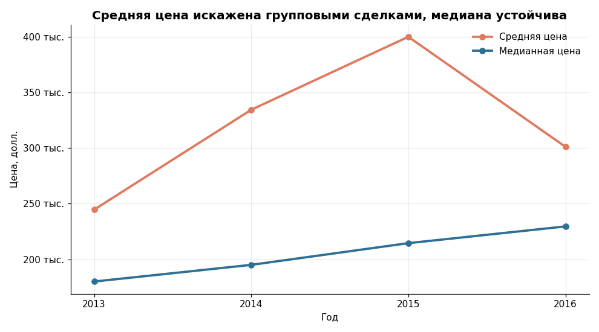

# Анализ продаж жилья в Нашвилле

Очистка «грязных» данных о продажах жилья в PostgreSQL, SQL-аналитика и визуализация в Python. Проект показывает полный цикл работы аналитика: от сырого файла до бизнес-выводов.

**Стек:** PostgreSQL, SQL (оконные функции, CTE, `PERCENTILE_CONT`), Python, pandas, matplotlib, Google Colab.

## Задача

Подготовить данные о продажах жилья к анализу и ответить на вопросы:

- как менялась цена на жильё в Нашвилле и его пригородах;
- в каких районах цены росли быстрее всего;
- есть ли сезонность в продажах;
- от чего зависит цена дома и можно ли доверять средней цене.

## Данные

Учебный набор данных о продажах недвижимости в Нашвилле (штат Теннесси): 56 477 строк, 19 столбцов (адрес, дата и цена продажи, тип землепользования, оценочная стоимость, год постройки, число спален и ванных и др.).

Продажи фактически охватывают **2013-2016 годы** (в 2019 году в данных всего две строки), поэтому весь анализ выполнен за 2013-2016.

Исходный файл: `data/NashvilleHousingData.xlsx`.

## Что сделано

### 1. Очистка данных в PostgreSQL (`sql/01_cleaning.sql`)

Работа ведётся в копии таблицы, исходные данные не изменяются.

| Проблема в данных | Решение | Результат |
|---|---|---|
| Двойные и лишние пробелы почти во всех адресах | `btrim` и `regexp_replace` | Адреса сравниваются корректно |
| 29 строк без адреса объекта | Заполнение по `ParcelID` из других строк, после проверки, что вариант адреса один | Пропусков не осталось |
| Адрес одной строкой («улица, город, штат») | `split_part` | Отдельные столбцы улицы, города и штата |
| Значения Y/N вместо Yes/No (451 строка) | `CASE WHEN` | Единый формат |
| Опечатки и разные написания в `LandUse` (`VACANT RES LAND`, `GRRENBELT/RES` и др.) | `CASE WHEN` | Единые категории |
| 104 дубля одной и той же продажи | `ROW_NUMBER() OVER (PARTITION BY ...)` | 56 477 строк стало 56 373 |

Важная деталь: у 243 участков в данных встречается больше одного адреса, поэтому пропущенные адреса не подставлялись вслепую, а сначала проверялось, что для каждой из 29 строк найден ровно один вариант.

### 2. SQL-аналитика (`sql/02_analysis.sql`)

Динамика цен по годам, рост по городам, сезонность, отношение цены к налоговой оценке, зависимость цены от числа спален, поиск выбросов.

### 3. Графики и выводы (`notebooks/03_charts.ipynb`)

Шесть графиков в Python с выводом для бизнеса после каждого.

## Ключевые выводы

**1. Рынок рос стабильно.** Медианная цена жилья (дома и жилые квартиры) выросла со 185 000 до 239 000 долларов за 2013-2016, примерно на 29%.



**2. Доступные пригороды росли быстрее дорогих.** Рост медианной цены с 2013 по 2016: Madison +41%, Nashville +31%, Old Hickory +29%, Hermitage +24%, Antioch +21%, Goodlettsville +21%, Brentwood +14%. Спрос смещался в более доступные районы.



**3. Продажи сезонны.** Пик приходится на май-август, минимум на январь-февраль и ноябрь. Рекламные бюджеты и сезонный найм агентствам имеет смысл смещать на весну и лето.



**4. Цена зависит от размера нелинейно.** Медианная цена частного дома: 3 спальни около 180 тысяч, 4 спальни около 345 тысяч, 5 спален около 583 тысяч. Переход от 3 к 4 спальням почти удваивает цену.



**5. Рыночные цены обгоняли налоговую оценку.** Отношение цены продажи к оценочной стоимости частных домов выросло с 1,02 в 2013 до 1,42 в 2016. Это сигнал о занижении налоговой базы.



## Находка: почему нельзя доверять средней цене

Из 163 продаж дороже 5 млн долларов 160 оказались групповыми сделками: цена всей сделки записана на каждый объект (например, 92 квартиры с ценой 13,2 млн за каждую). Из-за этого средняя цена по всем продажам взлетает до около 400 тысяч в 2015 году и падает до около 301 тысячи в 2016, хотя медианная цена растёт. Поэтому во всех выводах используется медиана, а из анализа жилья исключены сделки дешевле 10 000 и дороже 5 млн.



## Ограничения

- Данные охватывают только 2013-2016 годы и один регион (Нашвилл и ближайшие пригороды), переносить выводы на современный рынок нельзя.
- Города определены по почтовым адресам, а не по микрорайонам.
- Показано, что цены росли, но не почему (процентные ставки, миграция, новое строительство).
- Больше половины строк без данных о владельце и характеристиках дома (год постройки, число спален), поэтому анализ по этим признакам сделан на части выборки.

## Как воспроизвести

1. Загрузите `data/NashvilleHousingData.xlsx` в PostgreSQL (сохраните как CSV и импортируйте в таблицу `nashville_housing`; структура таблицы приведена в начале `sql/01_cleaning.sql`).
2. Выполните `sql/01_cleaning.sql`, затем `sql/02_analysis.sql`. Скрипты написаны для PostgreSQL, столбцы в нижнем регистре со знаком подчёркивания.
3. Выгрузите очищенную таблицу `nashville_clean` в CSV.
4. Откройте `notebooks/03_charts.ipynb` в Google Colab, запустите ячейки по порядку и выберите выгруженный CSV, когда ноутбук попросит файл.

## Структура репозитория

```
├── data/        исходный файл
├── sql/         очистка и аналитика
├── notebooks/   графики и выводы
└── charts/      графики из ноутбука
```

## Что можно сделать дальше

- Построить модель прогноза цены (градиентный бустинг) по площади, году постройки, числу спален и району с честной оценкой по времени.
- Выделить групповые сделки в отдельный признак и сравнить результаты с ними и без них.
- Разобрать 243 участка с несколькими адресами и выяснить, чем это вызвано.
